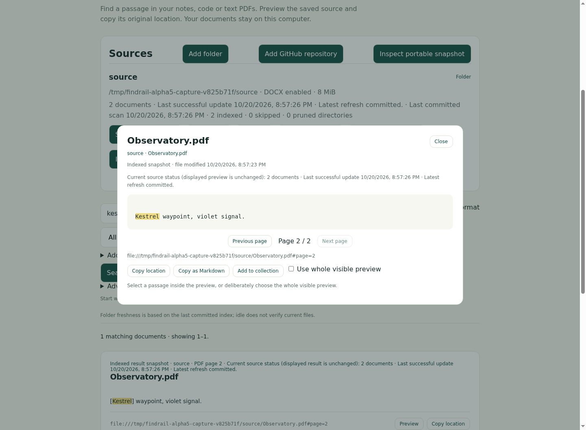

<p align="center">
  <picture>
    <source media="(prefers-color-scheme: dark)" srcset="docs/assets/findrail-wordmark-dark.svg">
    
  </picture>
</p>

<h3 align="center">You remember a word. Find the original.</h3>

<p align="center">
  Search your notes, code, PDFs and Word documents on your own computer.<br>
  Find the matching passage, check its source, and take the citation with you.
</p>

<p align="center">
  <a href="https://github.com/Lephiziel/findrail/actions/workflows/ci.yml"></a>
  <a href="https://github.com/Lephiziel/findrail/releases"></a>
  <a href="LICENSE"></a>
  <a href="#build-from-source"></a>
</p>

<p align="center">
  <a href="#quick-start"><strong>Download &amp; try</strong></a> ·
  <a href="docs/demo.md">Demo</a> ·
  <a href="#documentation">Documentation</a> ·
  <a href="docs/roadmap.md">Roadmap</a> ·
  <a href="CONTRIBUTING.md">Contribute</a> ·
  <a href="docs/ru/overview.md">Русский</a>
</p>

<p align="center">
  <a href="docs/demo.md"></a>
  <br>
  <sub>Published alpha.5 · synthetic documents · <a href="docs/assets/workflow-alpha5.mp4">watch the workflow</a> · <a href="docs/assets/README.md">capture details</a></sub>
</p>

See the [saved collection](docs/assets/collection-alpha5.png) and [freshness refresh](docs/assets/freshness-alpha5.png) in the same real alpha.5 capture. Historical alpha.3 screenshots and alpha.2 video remain documented separately.

Findrail brings the **words inside your files** into one local search index.
Choose the folders you want, search something you remember, and inspect the
indexed passage alongside its original location. Text PDFs include page numbers;
DOCX documents have plain-text body previews. Folder changes refresh the index
while Findrail runs.

The local folder workflow works offline, with **no account, AI model or document
uploads**. The standalone app includes its database and web interface; Go and
Python are only development tools.

> [!NOTE]
> **Early alpha — feedback welcome.** The current download is
> [0.1.0-alpha.5](https://github.com/Lephiziel/findrail/releases/tag/v0.1.0-alpha.5),
> with passage windows, paged results and explicit source/evidence transfer.
> [What's new](#new-in-alpha5) · [Verified release](docs/release-alpha5-verification.md).
> Beta.1 preparation: [limited-beta release notes](docs/release-notes-beta1.md)
> (preparation only; not a download or published release).
> Upgrading an existing index? [Stop and back up the whole data directory first](build/package/INSTALL.txt).
> Alpha.5 uses schema 8. Earlier binaries cannot open an index upgraded to
> schema 8; rollback requires the complete stopped pre-upgrade backup.

## A path back to your documents

<table>
  <tr>
    <td width="33%" valign="top">
      <h3>🔎 Search across files</h3>
      Notes, Markdown, common code files, text PDFs and DOCX body text. One query across the folders you choose.
    </td>
    <td width="33%" valign="top">
      <h3>📄 Check the passage</h3>
      Matching text, indexed previews, original locations and PDF page numbers keep every result attached to its source.
    </td>
    <td width="33%" valign="top">
      <h3>✍️ Take the evidence</h3>
      Select passages, explicitly save named collections with notes, and return after a restart. Export Markdown citations to your own tools.
    </td>
  </tr>
  <tr>
    <td valign="top">
      <h3>🔄 Keep folders fresh</h3>
      Live folder watching, source health and indexing reports. Failed scans preserve the last committed index.
    </td>
    <td valign="top">
      <h3>🎯 Narrow the search</h3>
      Source, format, path and title filters. Opt-in Advanced mode adds phrases, OR, exclusions and token prefixes.
    </td>
    <td valign="top">
      <h3>🔌 Use your workflow</h3>
      A CLI, local web UI, read-only HTTP and stdio MCP, plus an optional read-only VS Code client.
    </td>
  </tr>
</table>

<details>
<summary><strong>See a match on its PDF page</strong></summary>


Preview shows indexed text, with the original file location and page attribution.
It does not reproduce the PDF's visual layout.

</details>

You can also explicitly add **public GitHub file snapshots**, pinned to a
commit and refreshed manually, or transfer **portable indexed-text snapshots**
as independent frozen sources. [GitHub sources](docs/github.md) ·
[Portable snapshots](docs/portable-snapshots.md)

## Quick start

### 1. Download

Download **0.1.0-alpha.5** for your computer, verify the matching entry in
[SHA256SUMS.txt](https://github.com/Lephiziel/findrail/releases/download/v0.1.0-alpha.5/SHA256SUMS.txt),
then extract the archive into a folder you own.

| Linux | macOS | Windows |
|:---|:---|:---|
| [x86-64 / amd64](https://github.com/Lephiziel/findrail/releases/download/v0.1.0-alpha.5/findrail_0.1.0-alpha.5_linux-amd64.tar.gz) | [Apple Silicon / arm64](https://github.com/Lephiziel/findrail/releases/download/v0.1.0-alpha.5/findrail_0.1.0-alpha.5_darwin-arm64.tar.gz) | [x86-64 / amd64](https://github.com/Lephiziel/findrail/releases/download/v0.1.0-alpha.5/findrail_0.1.0-alpha.5_windows-amd64.zip) |
| [ARM64 / arm64](https://github.com/Lephiziel/findrail/releases/download/v0.1.0-alpha.5/findrail_0.1.0-alpha.5_linux-arm64.tar.gz) | [Intel / amd64](https://github.com/Lephiziel/findrail/releases/download/v0.1.0-alpha.5/findrail_0.1.0-alpha.5_darwin-amd64.tar.gz) | |

No Go, Python, database server or Docker setup is required. **macOS 13+** is
required for these macOS builds. The alpha binaries are unsigned; read the
bundled `INSTALL.txt` for platform-specific first-run instructions. On macOS,
an app-specific allowance may be needed in Privacy & Security. [Installation, upgrade and rollback](build/package/INSTALL.txt) ·
[Release manifest](https://github.com/Lephiziel/findrail/releases/download/v0.1.0-alpha.5/release-manifest.json)

### 2. Start

Launch from inside the extracted directory:

```bash
# Linux
./findrail-desktop

# macOS
open Findrail.app
```

```powershell
# Windows PowerShell
.\findrail-desktop.exe
```

Findrail opens its local browser interface. Launching it again reopens the
same running instance and index. Closing the tab keeps Findrail running;
choose **Quit Findrail** in the app to stop it. The desktop launcher chooses
an available loopback port.

Want an entry in your OS menu? Use the archive's per-user installer in
`launcher/linux/`, `launcher/macos/` or `launcher/windows/`.
[Desktop setup and uninstall](build/package/INSTALL.txt).

### 3. Find something you remember

In **Sources → Add folder**, enter the absolute path to a folder on this
computer. Search a word from one of your documents, open **Preview**, and check
the passage. Select text to copy a Markdown citation or add it to a named evidence
collection. Add a note and press **Save** to keep it across restarts with the
same data directory. A fresh index starts empty; Findrail scans only selected
sources.

> [!TIP]
> **Try it before adding your files.** Stop the app and run `./findrail demo`
> (Windows: `.\findrail.exe demo`). Search **idempotency** across three fictional
> documents, then preview `webhook-runbook.pdf` on **page 2**.
> [Follow the demo](docs/demo.md).

<details>
<summary><strong>Command-line examples</strong></summary>

```bash
# Run the foreground CLI with a separate index for this folder.
./findrail start --data-dir ./findrail-data /absolute/path/to/notes

# Query that same index from another terminal.
./findrail search --data-dir ./findrail-data --json "retry budget"
./findrail sources --data-dir ./findrail-data --json

# Check retrieval against a small labeled query corpus.
./findrail evaluate --data-dir ./findrail-data \
  --queries /absolute/path/to/queries.json --source SOURCE_ID --json
```

Options precede positional arguments. Use the same `--data-dir` each time.
The foreground `start` command normally uses **http://127.0.0.1:7766**;
keep its terminal open and stop it with **Ctrl+C**. Use `start --no-open` on a
headless machine. `demo` uses its own temporary index and does not accept
`--data-dir`.

[Query semantics](docs/search-query.md) · [Search evaluation](docs/search-evaluation.md) ·
[All commands and limits](docs/local-alpha.md)

</details>

## Your data stays yours

- **Explicit sources.** Select folders yourself. Hidden entries, symlinks,
  dependency directories and common credential filenames are skipped;
  [.findrailignore](docs/folder-ignore.md) adds folder-specific exclusions.
- **Local storage.** Extracted text, paths and provenance are stored as plaintext
  in a local SQLite index. The index is not encrypted at rest. Original files
  are left untouched, and the app has no runtime telemetry.
- **Local serving.** The web interface binds to loopback. Public GitHub indexing
  makes network requests only when you add or manually refresh a repository.
  An MCP client may forward retrieved passages to its configured model provider.
- **Copies need care.** Markdown citations and portable exports may contain
  private text and paths. Portable exports contain indexed text and provenance,
  rather than original files or a complete database backup.

> [!IMPORTANT]
> Stop Findrail and back up the **whole data directory** before upgrading.
> Alpha.5 uses schema **8**; alpha.4 uses **7** and alpha.3 uses **6**.
> Upgrades are forward-only: alpha.4 cannot open a schema-8 index.
> [Backup and rollback instructions](build/package/INSTALL.txt).

Search is lexical. **OCR, semantic search, private GitHub, team authentication
and automatic updates are not included.** Scanned PDFs need OCR; DOCX previews
do not reproduce Word layout or page numbers. Preview shows the indexed
snapshot, which may differ from the current file.
[Data handling](docs/data-handling.md) · [Extraction limits](docs/local-alpha.md)

## New in alpha.5

Find a late passage, navigate more results, and transfer selected evidence:

| Included in the current download | Details |
|:---|:---|
| Passage windows | Browse matching text and surrounding indexed context, including late Markdown and DOCX passages. PDF citations keep their page numbers. [Search guide](docs/search-query.md) |
| Paged results and presets | First/Previous/Next with page sizes 20/50/100 within a 1,000-result window. Apply a preset, then explicitly search. [Query behavior](docs/search-query.md) |
| Evidence bundles | Export saved citations and notes as JSON; map sources and preview conflicts before importing a new collection. [Bundle guide](docs/evidence-bundles.md) |
| Portable source transfer in Sources | Explicitly export, inspect and import indexed-text snapshots using paths on the Findrail computer. Imported sources stay frozen. [Snapshot guide](docs/portable-snapshots.md) |
| Freshness and recovery guidance | Distinguish indexed evidence from current originals; failed refreshes preserve committed results. [Freshness guide](docs/index-freshness.md) |

Desktop launch, opt-in original-file opening and saved named collections remain
available. The release passed five native package jobs, packaged browser,
installed VSIX, upgrade/restore and recovery checks. The owner reported the
supplied Linux candidate check working. [Release verification and coverage](docs/release-alpha5-verification.md) ·
[Release notes](docs/release-notes-alpha5.md) · [Roadmap](docs/roadmap.md)

The read-only `serve` and `demo` interfaces keep temporary in-tab collections;
original-file opening is opt-in in `start` / desktop. Saved collections are
historical indexed passages, not live copies of the original files.

## Documentation

| Start here | Go deeper |
|:---|:---|
| [Desktop first use and optional feedback](docs/beta-start-here.md) · [Demo](docs/demo.md) | [Architecture](docs/architecture.md) |
| [Source management](docs/source-management.md) | [HTTP API](api/openapi.yaml) |
| [Search queries and filters](docs/search-query.md) | [Read-only MCP setup](docs/mcp.md) |
| [DOCX support](docs/docx.md) | [Optional VS Code client](docs/vscode.md) |
| [Indexing diagnostics](docs/indexing-diagnostics.md) | [Search evaluation](docs/search-evaluation.md) |
| [Portable snapshots](docs/portable-snapshots.md) | [Experimental connector kit](docs/connectors.md) |
| [Release checks](docs/release-alpha5-verification.md) | [Product direction](docs/product.md) |
| [Beta.1 platform and preparation policy](docs/beta-support.md) | [Beta evidence handoff contract](docs/beta-evidence.md) |
| [Русский обзор](docs/ru/overview.md) | [Contributing](CONTRIBUTING.md) |

## Build from source

Requires **Go 1.26+**. No CGO is required. Published packages and their exact
source revision are listed in the [release verification](docs/release-alpha5-verification.md).

```bash
git clone https://github.com/Lephiziel/findrail.git
cd findrail
go build -o bin/findrail ./cmd/findrail
./bin/findrail demo
```

For a source-built desktop launcher:

```bash
go build -o bin/findrail-desktop ./cmd/findrail-desktop
./bin/findrail-desktop --data-dir ./findrail-test-data
```

Use fictional documents and a separate data directory for first tests.
[Repository structure and boundaries](docs/architecture.md) ·
[Development checks](CONTRIBUTING.md)

## Help shape Findrail

Try finding **two real passages whose words you remember**. Tell us what you
searched, whether you found the original, and where the workflow got in your way.
Your OS and app version help reproduce a problem; share synthetic or redacted
examples rather than private documents.

[Give alpha feedback](https://github.com/Lephiziel/findrail/issues/3) ·
[Report a bug](https://github.com/Lephiziel/findrail/issues/new/choose) ·
[Contribute](CONTRIBUTING.md)

Findrail is licensed under [Apache-2.0](LICENSE). The local product remains
independently usable. [Governance](GOVERNANCE.md).
